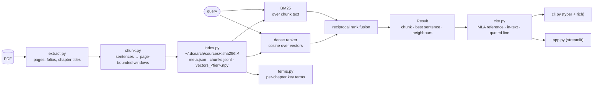

# Architecture

dsearch is a pipeline of five pure-ish stages and two thin front ends. Each
module in `src/dsearch/` is importable and testable on its own; the CLI and
the Streamlit app call the same functions, so they cannot disagree about a
ranking.



## Stages

| Stage | Input → output | What it promises |
|---|---|---|
| `extract` | PDF path → `list[Page]` | One `Page` per PDF page: faithful text with ligatures expanded and endnote markers dropped, the *printed* folio if one is in the header/footer band, the chapter title from the outline or from font-size headings. Raises `NoTextLayerError` on a scan. |
| `chunk` | pages → `list[Chunk]` | Running heads and bare folios removed, hyphenated words rejoined, prose split into sentences, sentences windowed into overlapping chunks. **A chunk never crosses a page break**, so every chunk cites one page. |
| `index` | chunks → files on disk | A source is keyed by the SHA-256 of its bytes. Row *i* of `vectors_<tier>.npy` is chunk *i*. Re-adding is a no-op; a new tier embeds only the missing vectors; `index_version` triggers a rebuild when extraction changes. |
| `search` | query + library → `list[Result]` | Dense cosine and BM25 ranked separately, fused by reciprocal rank (scores on different scales cannot be added). Long queries are embedded sentence by sentence with max-pooling. The best sentence in each result is chosen by embedding similarity. |
| `cite` | result + metadata → strings | MLA 9 reference, in-text parenthetical, and the quoted sentence with correct terminal punctuation. Unknown elements are omitted, never invented. |
| `terms` | stored chunks + vectors → `BookTerms` | Words and phrases a chapter uses far more than its siblings, re-ranked by the chapter's embedding direction. Reads the index; never re-embeds. |

## Data model

```python
Page(pdf_page: int, text: str, printed_page: int | None, chapter: str | None)
Chunk(chunk_id: int, source_id: str, text: str, sentences: list[str],
      pdf_page: int, printed_page: int | None, chapter: str | None)
SourceMeta(source_id, filename, title, author, added, page_count, chunk_count,
           chunk_size, overlap, tiers, index_version, path)
Result(chunk, score, best_sentence, meta, before, after)
```

`(source_id, chunk_id)` identifies a chunk globally and `chunk_id` is the
vector row index, which is what lets later features (key terms today, a 2D
map and a benchmark next) read the stored data without re-indexing.

## On disk

```
~/.dsearch/                      # or $DSEARCH_HOME
├── library.json                 # list of SourceMeta
├── config.json                  # measured embedding rate per tier
└── sources/<sha256>/
    ├── meta.json                # the same SourceMeta
    ├── chunks.jsonl             # one Chunk per line, in chunk_id order
    └── vectors_<tier>.npy       # float32 (n_chunks, dim), L2-normalised
```

Models are cached by Hugging Face under `~/.cache/huggingface/hub/`.

## The two front ends

`cli.py` renders results as Rich panels and takes `--json` for scripts.
`app.py` renders the same `Result` objects as cards, keeps the last search in
session state so widget changes do not re-search, and memoises searches on
the query and the library's modification time. Both call `search.search`,
`index.add`, and `cite.*` directly; neither contains retrieval logic.

## Where the next features plug in

- **Benchmark** (`evaluate.py`): builds a library from the bundled sample
  under a temporary `DSEARCH_HOME`, runs labelled queries through `search`,
  reports recall/MRR/nDCG. Needs only the public `search` API.
- **Lexical index** (`lexical.py`): replaces the per-query BM25 build with a
  per-source index written next to `chunks.jsonl`.
- **Reranker** (`rerank.py`): a cross-encoder scoring the top fused
  candidates, inserted between `rrf` and `Result`.
- **Readers** (`extract/`): one module per format producing `list[Page]`;
  `Page` gains a `kind` and a `location` so citations can say "ch. 3" when
  there is no page.
